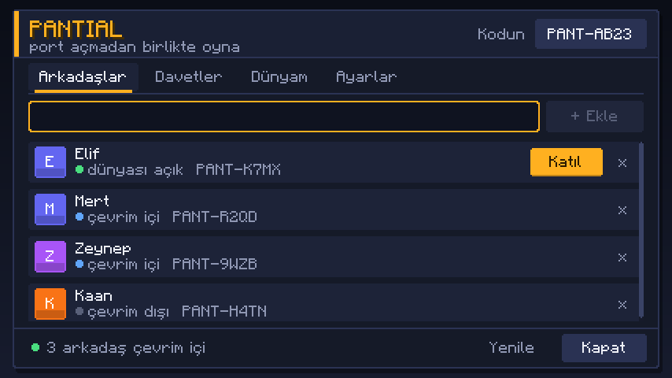

# Pantial - Minecraft P2P LAN & Varlık Ağı

Pantial; port yönlendirme (port forwarding) gerektirmeden, arkadaşlarınızla yerel Minecraft dünyalarınızı paylaşmanızı ve tek tıkla birlikte oynamanızı sağlayan açık kaynaklı bir mod ve sunucu ekosistemidir.

---



## İndirme

[**Releases**](https://github.com/Armone0/pantial/releases) sayfasından Minecraft sürümüne uyan
`pantial-fabric-…+<minecraft>.jar` dosyasını indirip `mods` klasörüne at.
Gerekenler: Fabric Loader + Fabric API. Dünyayı internete açmak için [e4mc](https://modrinth.com/mod/e4mc) önerilir.

| Minecraft | Jar |
| :--- | :--- |
| 1.18.2 | `+1.18.2` |
| 1.19 – 1.19.2 / 1.19.3 – 1.19.4 | `+1.19.2` / `+1.19.4` |
| 1.20 – 1.20.1 / 1.20.3 – 1.20.4 / 1.20.5 – 1.20.6 | `+1.20.1` / `+1.20.4` / `+1.20.6` |
| 1.21 – 1.21.1 / 1.21.2 – 1.21.4 / 1.21.5 | `+1.21.1` / `+1.21.4` / `+1.21.5` |
| 1.21.6 – 1.21.8 / 1.21.9 – 1.21.10 / 1.21.11 | `+1.21.8` / `+1.21.10` / `+1.21.11` |
| 26.1.x / 26.2.x / 26.3.x | `+26.1.2` / `+26.2` / `+26.3` |

Şimdilik yalnızca **Fabric**. Forge/NeoForge yol haritasında.

## Oyunda

Ana menü, duraklatma ve çok oyunculu ekranlarının sağ üstünde **Pantial** düğmesi çıkar. Menüde:

- **Arkadaşlar** – `PANT-XXXX` koduyla arkadaş ekle/sil, kimin çevrim içi olduğunu ve dünyası açık olanları gör, tek tıkla katıl, kendi dünyana davet et
- **Davetler** – gelen davetleri kabul et ya da reddet
- **Dünyam** – tek oyunculu dünyanı paylaş (oyun modu, hileler, kimlik doğrulama, port); e4mc adresini kopyala, çevrim içi arkadaşları toplu davet et
- **Ayarlar** – varlık sunucusu adresi, bildirimler, ana menü düğmesi

Kodun sağ üstte; tıklayınca panoya kopyalanır. Ayarlar `config/pantial.json` içinde.

## Mimari

```
server.js            Varlık sunucusu (Node.js, bağımlılık yok)
mod/
├── common/          Sürümden bağımsız kod: profil, sunucu istemcisi, menü (kendi çizim katmanıyla)
├── platform/<aile>/ Minecraft API ailesi başına ince katman (çizim, girdi, ekranlar, bildirim)
└── versions/<mc>/   Her Minecraft sürümü için ayrı alt proje → ayrı jar
```

Menü Minecraft widget'larını kullanmaz; `Gfx` arayüzü üzerinden kendisi çizer. Bu yüzden her sürümde aynı
görünür ve yeni bir sürüm eklemek genelde yalnızca platform katmanında birkaç satır değişiklik ister.

### Derleme

```bash
cd mod
./gradlew collectJars                       # tüm sürümler → mod/build/release/
./gradlew collectJars -Ppantial.only=1.20.1 # tek sürüm
./gradlew :1.21.11:runClient                # geliştirme istemcisi
```

Java 25 gerekir (26.x için); eski sürümler `--release 17/21` ile derlenir.

### Yeni sürüm yayınlama

`v` ile başlayan bir etiket push'layınca (ör. `v1.1.0`) GitHub Actions tüm sürümleri derler, sunucu paketini
hazırlar ve hepsini Release'e ekler. Açıklama metni `RELEASE_NOTES.md` dosyasından gelir.

---

## Sunucu Kurulumu ve Çalıştırma

### Hızlı Başlatma
- **Windows:** `start.bat` dosyasını çift tıklayın veya çalıştırın.
- **Linux / macOS:** `./start.sh` veya `npm start` çalıştırın.

```bash
# Sunucuyu başlatma
node server.js

# Test paketini çalıştırma
npm test
```
Varsayılan olarak `3000` portunda çalışır.

### Başlıca API Endpoint'leri
- `GET /api/health` - Sunucu durum ve aktif oyuncu istatistikleri
- `GET /api/generate-code` - Benzersiz `PANT-XXXX` formatında arkadaş kodu üretme
- `GET /api/players`, `GET /api/status?userCode=` - Herkese açık özet (tünel adresi içermez)
- `POST /api/register` - `{userCode, secret, username, uuid}` ile kayıt
- `POST /api/host` - Yerel dünya tünel adresini duyurma
- `POST /api/status` - Arkadaş listesi ve gelen davetleri sorgulama
- `POST /api/invite` - Arkadaşını paylaşılan dünyaya davet etme (`to`, `tunnelUrl`)
- `POST /api/reject-invite` - Sana gelen daveti kapatma (`from`)
- `POST /api/stop-host` - Dünya paylaşımını sonlandırma

**Kimlik:** İstemci ilk kayıtta rastgele bir `secret` üretir ve sunucu bunu koda bağlar. `register`
dışındaki tüm POST istekleri `userCode` + `secret` ister; yanlışsa `401`, kod başkasına aitse `403` döner.
Böylece biri senin kodunu alıp arkadaşlarına sahte dünya adresi duyuramaz. Kayıtlar bellekte tutulur,
sunucu yeniden başlayınca istemciler otomatik tekrar kayıt olur. Sunucuyu internete açacaksan önüne HTTPS koy.

---

## Lisans
Manifestlerde MIT yazıyor ama repoda henüz `LICENSE` dosyası yok.
